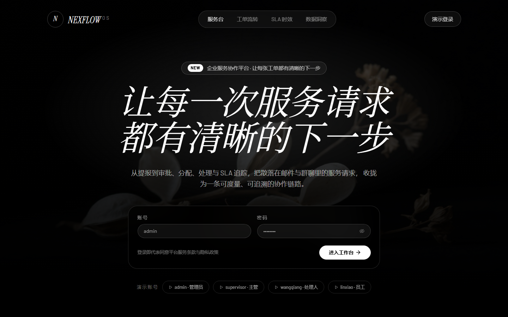
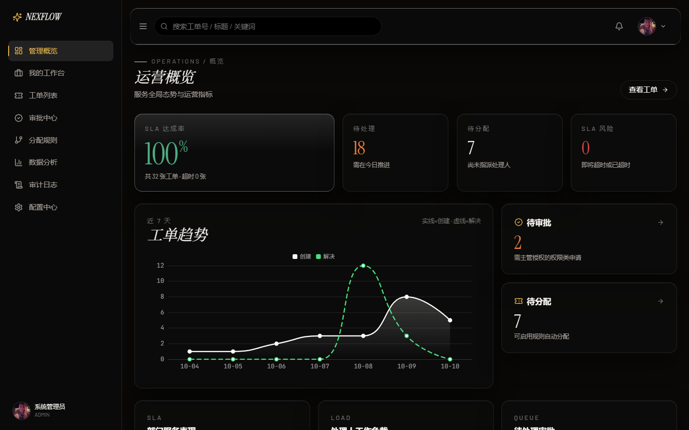
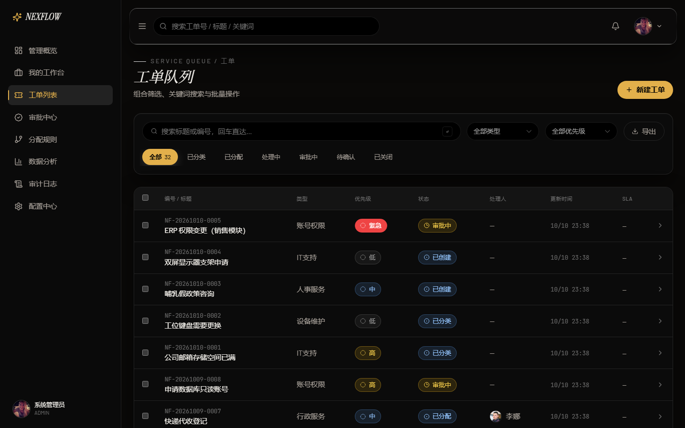
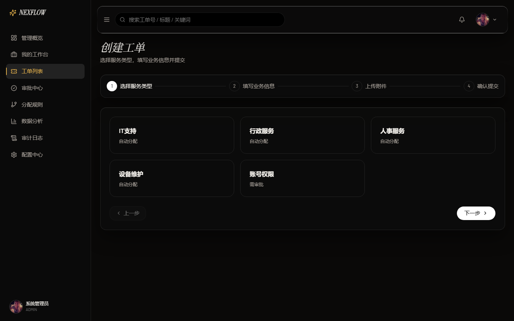
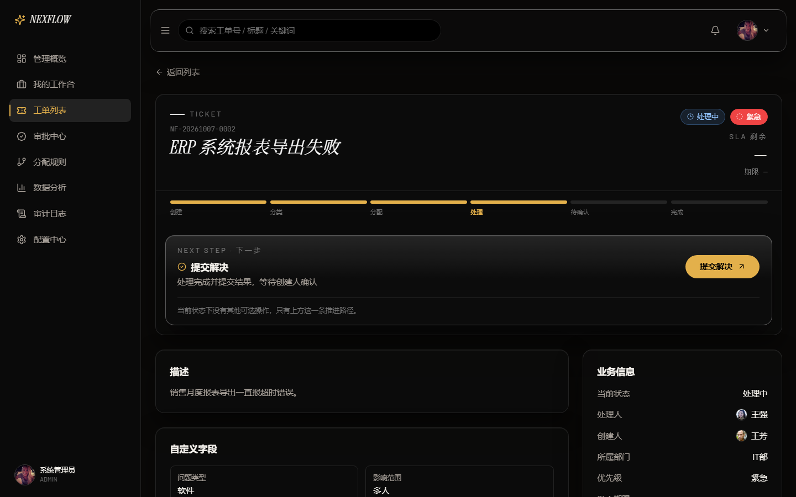
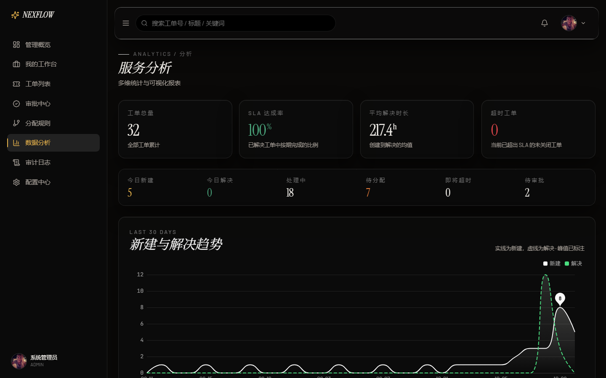
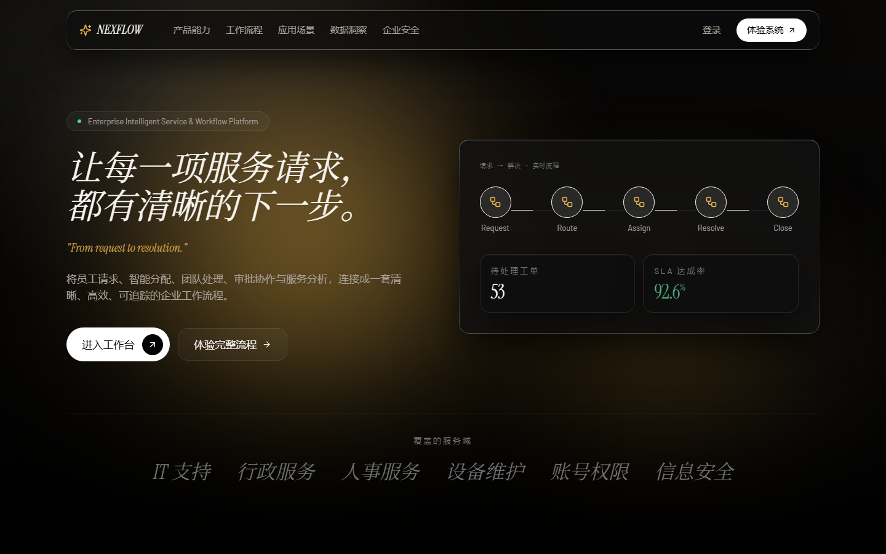
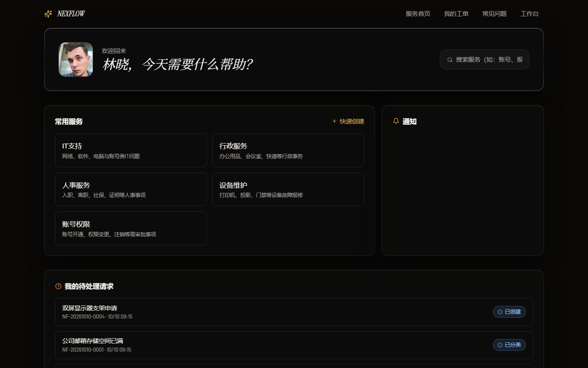
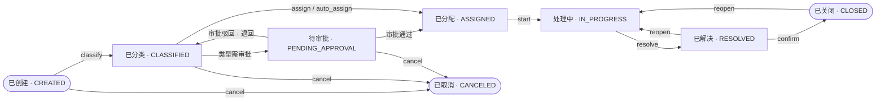

# NEXFLOW · 企业智能服务协作平台

> **让每一项服务请求，都有清晰的下一步。**

从提单到归档，把散落在邮件和群聊里的服务请求，收敛成一条**可度量、可追溯**的协作链路：

`提交 → 分类 → 审批 → 智能分配 → 处理 → 确认 → 关闭`

NEXFLOW 是一个**前后端完整落地**的企业级 ITSM 服务台：Vue 3 + TypeScript 前端、Spring Boot 3.5 + Java 25 后端、H2 / MySQL 双数据库、Docker Compose 一键部署，含 15 个端到端集成测试。


---

## 界面速览

<table>
<tr>
<td width="50%">

**登录 · 演示入口**
内置 4 类演示角色，一键切换管理员 / 主管 / 处理人 / 员工视角。



</td>
<td width="50%">

**运营看板 · 全局态势**
SLA 达成率、待处理、待分配、SLA 风险四张指标卡 + 近 7 天新建/解决趋势。



</td>
</tr>
<tr>
<td width="50%">

**工单队列 · 组合筛选**
状态页签 + 类型/优先级筛选；优先级与 SLA 用语义色区分，紧急与超时一眼可辨。



</td>
<td width="50%">

**创建工单 · 四步向导**
选择服务类型 → 填写业务信息 → 上传附件 → 确认提交，按类型动态渲染自定义字段。



</td>
</tr>
<tr>
<td width="50%">

**工单详情 · 下一步建议**
状态进度条、`legalActions` 驱动的「下一步」建议、处理轨迹与评论时间线。



</td>
<td width="50%">

**服务分析 · 多维统计**
工单总量、SLA 达成率、平均解决时长、超时工单，以及 30 天趋势与部门绩效。



</td>
</tr>
<tr>
<td width="50%">

**品牌官网 · 产品叙事**
面向访客的能力介绍：流程编排、应用场景、数据洞察、企业安全。



</td>
<td width="50%">

**员工门户 · 自助服务**
服务目录、快速创建、我的待处理请求、常见问题，员工自助不依赖客服。



</td>
</tr>
</table>

---

## 工单生命周期

NEXFLOW 的核心是一条受状态机约束的工单流转链路：**8 个状态、8 个流转动作**。每个动作都会经过「角色权限 → 数据域 → 前置条件」三重校验，非法流转由服务端直接拒绝，前端只渲染后端认可的下一步操作。



- **谁能推进** — 分类与分配由服务台（主管 / 管理员）执行；开始处理与提交解决由处理人执行；确认关闭、取消、重新打开由创建人或主管执行。
- **自动分配** — 类型标记为「自动分配」时，分类动作结束即按分配规则匹配处理人；未命中规则则停留在「已分类」，等待人工分配。
- **审批前置** — 类型标记为「需审批」时，分类后进入待审批；审批通过后继续流转，驳回则退回「已分类」。
- **SLA 与留痕** — SLA 在分类时起算；工单被重新打开时自动顺延暂停时长。每次流转都会写入状态历史、推送通知并记录审计日志。

---

## 这个项目是什么

企业内部每天都有大量「找 IT 开权限」「找行政补耗材」「找人事问政策」的请求。它们通常散落在邮件、群聊和口头沟通里：**没有统一入口、没有时效承诺、没有人知道现在卡在谁手上。**

NEXFLOW 把这条链路产品化：

| 角色 | 关心什么 | 在 NEXFLOW 里得到什么 |
|---|---|---|
| 普通员工 | 我提的事到哪一步了 | 自助门户：一句话描述即可提单，全程可见进度与时效 |
| 处理人 | 我该先做哪一件 | 个人工作台：按优先级与 SLA 紧迫度排序的待办队列 |
| 主管 / 管理员 | 团队效率与瓶颈在哪 | 运营看板与分析：SLA 达成率、部门绩效、负载分布、超时风险 |
| 平台方 | 规则怎么落地、谁改了什么 | 配置中心（类型 / 自定义字段 / SLA / 分配规则）+ 操作审计 |

**三套体验空间，一套后端：**

- `/` **品牌官网** — 产品能力、工作流程、应用场景、数据洞察、企业安全
- `/portal` **员工自助门户** — 服务目录、快速请求、我的工单、FAQ
- `/app` **企业运营工作台** — 看板 / 工单列表 / 详情 / 创建 / 审批中心 / 分配规则 / 数据分析 / 审计日志 / 配置中心（按角色动态渲染导航）

---

## 技术栈

### 前端

| 技术 | 版本 | 在本项目中的用途 |
|---|---|---|
| Vue 3 (`<script setup>`) | 3.5 | 全部界面，组合式 API + 纯 TS |
| TypeScript | 5.7 | 全量类型定义（DTO / 状态机 / 接口契约），`vue-tsc` 零错误 |
| Vite | 6 | 开发服务器与生产构建；`/api` 代理到后端，开发态同源免 CORS |
| Pinia | 3 | 认证态、演示数据回退态 |
| Vue Router | 4 | 三套布局的嵌套路由 + 路由守卫（`requiresAuth` / `roles` / `permission`） |
| Tailwind CSS | 3.4 | 布局与工具类，配合 CSS 变量令牌 |
| Element Plus | 2.9 | 表格、表单、弹层；弹层过渡统一覆写为项目动效曲线 |
| ECharts | 5.6 | 趋势、部门绩效、负载、队列等图表 |
| lucide-vue-next | 0.469 | 图标系统 |
| axios | 1.7 | HTTP 层，统一请求/响应拦截与 401 处理 |

### 后端

| 技术 | 版本 | 在本项目中的用途 |
|---|---|---|
| Spring Boot | 3.5.16 | 应用骨架（Web + JPA + Security + Validation + AOP） |
| Java | 25 | 语言与运行时 |
| Spring Security + jjwt | — | 无状态 JWT 认证 + 基于权限码的 RBAC |
| Spring Data JPA / Hibernate | — | 实体映射与仓储；本地 `update`、生产 `validate` |
| Bean Validation | — | 请求体与动态自定义字段的必填/格式校验 |
| Spring AOP | — | 审计切面，统一记录「谁在何时对什么做了什么」 |
| SSE (`SseRegistry` / `SseHeartbeat`) | — | 通知实时推送（含心跳保活） |
| Lombok | 1.18.42 | 减少实体样板代码 |
| JUnit 5 + MockMvc | — | 15 个端到端接口集成测试 |

### 数据与部署

| 技术 | 用途 |
|---|---|
| H2（文件库，MySQL 兼容模式） | 本地开发；数据落盘 `backend/data/`，**重启不丢**；首次运行自动播种演示数据 |
| MySQL 8 | 生产运行（`prod` profile，`ddl-auto: validate`） |
| Docker Compose | `docker/docker-compose.yml` 一键起 MySQL 8 + backend |

---

## 关于 AI 协作

本项目采用 **AI 辅助开发（AI-assisted development）** 的工作方式完成：由人工主导产品定义与技术决策，由 AI 承担规模化编码，二者配合将需求落地为可运行、可测试、可部署的完整系统。

**人工主导**

- **需求拆解与范围界定** — 明确 ITSM 服务台的最小可用边界（工单、状态机、SLA、审批、分配、审计、配置），并主动裁剪聊天、报表订阅等非核心分支。
- **架构与数据契约设计** — 在编码前固定实体模型、状态枚举、`{ code, message, data, fieldErrors }` 统一响应契约与 `legalActions` 流转协议，使前后端基于稳定契约并行推进。
- **验收标准与端到端验证** — 15 个集成测试覆盖核心业务闭环（状态机全流程、跨部门自动分配、审批与工单状态一致性），并完成前后端联调与浏览器端验收。
- **代码审阅与缺陷定位** — 对 AI 产出逐项复核。典型一例：工单列表行 hover 的光扫动画最初以 `transform` 位移实现，而被 transform 的伪元素仍会撑大祖先 `overflow:auto` 容器的可滚动区域，导致横向滚动条反复闪现、hover 状态随之丢失；定位根因后改用 `background-position` 动画（背景不参与布局计算），问题彻底消除。

**AI 承担**

- 依据既定契约批量生成 CRUD、DTO、仓储与前端视图；跨 100+ 文件的机械性重构；样式令牌的统一替换；注释与文档初稿。

**小结**

AI 显著降低了编码成本，项目的实际瓶颈因此落在**架构判断、契约设计与验收把关**上。本仓库希望呈现的是一个在 AI 辅助下依然完整交付、且经得起运行与测试检验的工程成果。

---

## 架构与关键设计

```
frontend/                      backend/
├─ src/views/brand   品牌官网   ├─ auth/         JWT 认证、登录、UserDto
├─ src/views/portal  员工门户   ├─ ticket/       工单聚合（列表/详情/评论/自定义字段值）
├─ src/views/app     运营工作台 ├─ workflow/     状态机 WorkflowEngine + 合法动作推导
├─ src/layouts/      三套布局   ├─ assignment/   分配规则引擎 + 候选评估
├─ src/api/          HTTP 层    ├─ approval/     审批请求与决策
├─ src/stores/       Pinia      ├─ sla/          SLA 计算器 + 扫描调度 + 节假日
├─ src/mock/         演示数据   ├─ stats/        统计聚合
└─ src/styles/       设计令牌   ├─ audit/        AOP 审计切面
                                ├─ notification/ 通知 + SSE
                                ├─ configcenter/ 用户/部门/角色/类型/自定义字段
                                └─ common/       统一响应、异常处理、分页
```

几个值得一看的设计点：

- **统一响应契约** — 所有业务接口返回 `{ code, message, data, fieldErrors }`，`code = 0` 为成功；`fieldErrors` 让表单校验错误能精确落到具体字段。见 [docs/api-contract.md](docs/api-contract.md)。
- **状态机驱动 UI** — 工单流转统一走 `POST /api/tickets/{id}/{action}`。后端返回 `legalActions`，前端只渲染后端认可的下一步，**前端不会出现非法操作按钮**，服务端也二次拒绝非法流转。
- **智能分配** — `AssignmentEngine` 按规则匹配类型/优先级/部门，支持轮询与负载策略；`preview` 接口可在保存规则前评估候选人与命中原因。
- **SLA 时效** — `SlaCalculator` 结合 SLA 策略与节假日日历计算截止时间，产出 `OK / AT_RISK / BREACHED` 风险等级，列表与详情共用同一口径；`SlaScanScheduler` 定时扫描并推送预警。
- **审计切面** — 注解式 AOP 记录操作轨迹。真实 IP 会做归一化：纯本机访问时 `getRemoteAddr()` 返回 IPv6 回环 `0:0:0:0:0:0:0:1`，写入日志既长又难读，因此统一归一为 `127.0.0.1`，并还原 IPv4-mapped 形式，反代场景优先取 `X-Forwarded-For` / `X-Real-IP`。
- **AI 能力是可插拔的旁路** — `AiProvider` 接口 + `NoOpAiProvider` / `RuleAiProvider` 实现。默认关闭（`app.ai.enabled=false`），**关闭时核心流程完全不受影响**，开启后可提供分类建议与摘要。
- **离线演示回退层** — 前端 `withDemoFallback()`：后端可达时走真实 API，不可达时自动回退到演示数据并在页面标注「演示数据（未连接后端）」。这既让纯前端演示成为可能，也让界面开发不必等后端。
- **设计系统：色相只给含义** — 结构、排版、控件全部保持黑白灰；彩色只保留给状态、优先级与 SLA 压力三类语义（紧急/超时红、高/即将超时琥珀、中蓝、正常/待确认绿）。所有颜色收敛到 `--nf-*` CSS 变量与 Tailwind `theme.extend.colors` 单一来源。

---

## 快速开始

### 后端（端口 8080）

**在 IntelliJ IDEA 中运行**

1. `File → Open`，选择 `backend` 目录（即含 `pom.xml` 的那一层），以 Maven 项目导入，等待依赖下载完成。
2. 确认 `File → Project Structure → Project SDK` 为 **JDK 25**（本项目 `pom.xml` 的 `java.version` 为 25）。
3. 确认已开启注解处理：`Settings → Build → Compiler → Annotation Processors → Enable annotation processing`（Lombok 依赖此项，IDEA 通常会在导入时提示）。
4. 运行 `src/main/java/com/nexflow/NexflowApplication.java` 的 `main` 方法。
5. 以 `local` profile 启动：`Run → Edit Configurations → Active profiles` 填 `local`；`application.yml` 中已默认 `spring.profiles.active: local`，直接运行即可。
6. 控制台出现 `Started NexflowApplication` 即成功。

**命令行等价方式**

```bash
cd backend
mvn spring-boot:run -Dspring-boot.run.profiles=local
# 或先打包再运行（产物可独立部署）
mvn package && java -jar target/nexflow-backend-1.0.0.jar --spring.profiles.active=local
```

- 本地默认 H2 文件数据库（`backend/data/nexflow`），**重启数据不丢**
- 首次运行自动播种演示数据（权限 / 角色 / 部门 / 用户 / 工单类型 / 自定义字段 / SLA / 分配规则 / FAQ / 32 张工单）
- 播种是幂等的：已有用户时直接跳过，不会重复写入
- H2 控制台：<http://localhost:8080/h2-console>（JDBC URL `jdbc:h2:file:./data/nexflow`，用户 `sa`，空密码）
- 想重新播种：删除 `backend/data` 目录后重启

### 前端（端口 5173）

```bash
cd frontend
npm install
npm run dev
```

Vite 已将 `/api` 代理到 `http://localhost:8080`（同源，因此开发态不依赖 CORS 配置）。

> **两种运行模式**
>
> - **全栈联调**：先后端后前端，登录、工单、审批、统计、配置全部走真实 REST API。
> - **离线演示**：只启动前端，API 不可达时自动回退到前端演示数据，并在页面上标注「演示数据（未连接后端）」，便于区分。

---

## 演示账号（数据均为演示数据）

### 前端离线演示模式

| 账号 | 密码 | 角色 | 登录后落地页 |
|---|---|---|---|
| admin | admin123 | 管理员 | /app/dashboard（可见全部菜单） |
| supervisor | sup123 | 主管 | /app/dashboard |
| wangqiang | wq123 | 处理人 | /app/workbench |
| linxiao | lx123 | 普通员工 | /app/workbench |

### 后端种子账号（联调模式）

后端播种的完整账号集合（连接真实 API 时可用）：

| 账号 | 密码 | 角色 |
|---|---|---|
| admin | admin123 | 管理员 |
| supervisor | sup123 | 主管 |
| wangqiang | wq123 | 处理人（IT） |
| limin | lm123 | 处理人（行政） |
| zhangting | zt123 | 处理人（人事） |
| zhaolei | zl123 | 处理人（设备） |
| linxiao | lx123 | 普通员工 |
| wangfang | wf123 | 普通员工 |

---

## 测试与质量

后端集成测试位于 `backend/src/test/java/com/nexflow/NexflowApiIntegrationTest.java`，
使用 `@SpringBootTest` + `MockMvc`，跑在独立的**内存 H2**（`test` profile）上，不会污染本地开发库。

```bash
cd backend
mvn test          # 仅测试
mvn package       # 测试 + 打包可执行 jar
```

**最近一次执行结果：`Tests run: 15, Failures: 0, Errors: 0, Skipped: 0` — BUILD SUCCESS**

| # | 用例 | 覆盖点 |
|---|---|---|
| 1 | 登录返回 JWT 与角色权限 | 认证、权限装载 |
| 2 | 未携带 token 访问受保护接口 → 401 | 服务端认证强制 |
| 3 | 配置中心接口统一包封 | 懒加载 500 的回归防线 |
| 4 | 通知列表包封与分页结构 | 响应契约一致性 |
| 5 | 普通员工访问配置中心 → 403 | RBAC 服务端强制 |
| 6 | 缺失必填自定义字段 → 拒绝 | 自定义字段校验 |
| 7 | 创建工单并持久化自定义字段值 | CRUD + 持久化 |
| 8 | **状态机全流程：创建→分类→自动分配→处理→解决→关闭** | 核心业务闭环 |
| 9 | **跨部门工单也能自动分配** | 分配规则匹配语义的回归防线 |
| 10 | **审批中工单必有待审批记录** | 种子数据一致性（防止工单卡死、审批中心为空） |
| 11 | **审批通过后工单离开待审批状态** | 审批对流程的实际约束 |
| 12 | 非法流转被拒绝且状态不变 | 状态机约束 |
| 13 | 评论写入并出现在详情中 | 评论持久化 |
| 14 | 新建工单后统计总量 +1 | 统计与数据库一致 |
| 15 | 列表分页结构与关键字过滤 | 查询能力 |

前端类型校验与构建：

```bash
cd frontend
npx vue-tsc --noEmit -p tsconfig.json   # 类型检查
npm run build                            # 生产构建
```

---

## REST API 一览

所有业务接口统一返回 `{ code, message, data, fieldErrors }`，`code = 0` 表示成功。

| 分组 | 路径前缀 | 说明 |
|---|---|---|
| 认证 | `/api/auth` | 登录、当前用户 |
| 工单 | `/api/tickets` | 列表 / 详情 / 创建 / 状态流转 / 批量 / 评论 |
| 审批 | `/api/approvals` | 待审批列表、审批决策 |
| 分配 | `/api/assignment-rules` | 规则 CRUD、候选人评估 `preview` |
| SLA | `/api/sla` | 策略列表 |
| 统计 | `/api/stats` | 概览 / 趋势 / 部门绩效 / 负载 / 队列 / SLA 风险 |
| 通知 | `/api/notifications` | 列表、已读，另有 SSE 流 `/api/notifications/stream` |
| 门户 | `/api/portal`、`/api/knowledge`、`/api/search` | 门户首页、FAQ、全局搜索 |
| 配置 | `/api/config` | 用户 / 部门 / 角色 / 工单类型 / 自定义字段 |
| 审计 | `/api/audit-logs` | 操作审计 |
| 文件 | `/api/files` | 附件上传下载 |
| AI | `/api/ai` | 可选的分类建议 / 摘要 / FAQ 推荐（`app.ai.enabled=false` 时核心功能不受影响） |

工单状态流转统一走 `POST /api/tickets/{id}/{action}`，`action` 取值与详情返回的
`legalActions[].action` 完全一致：`classify` / `assign` / `auto_assign` / `start` / `resolve` / `confirm` / `reopen` / `cancel`。

---

## 切换 MySQL 8（生产）

1. 启动本机 MySQL 服务，创建库与账号（参考 [docker/mysql/init.sql](docker/mysql/init.sql)）
2. 以 `prod` profile 运行：`mvn spring-boot:run -Dspring-boot.run.profiles=prod`
3. 或用 Docker：`docker compose -f docker/docker-compose.yml up --build`

环境变量：`NEXFLOW_DB_URL` / `NEXFLOW_DB_USER` / `NEXFLOW_DB_PASSWORD` / `NEXFLOW_JWT_SECRET`。

> 生产 profile 使用 `ddl-auto: validate`——表结构由迁移脚本负责，应用不擅自改表。

---

## 路线图 Roadmap

### 近期（把「可用」变成「好用」）

- [ ] **工单看板视图** — 按状态分列的拖拽式看板，替代纯列表视角
- [ ] **通知中心落地** — 打通 SSE 前端消费，站内信 + 未读计数 + 浏览器桌面通知
- [ ] **SLA 策略可视化编辑** — 配置中心内直接编辑响应/解决时限与节假日日历
- [ ] **移动端适配** — 员工门户与工单详情优先做响应式，支持手机提单与确认
- [ ] **无障碍与键盘操作** — 焦点管理、ARIA 标注、快捷键

### 中期（把「单实例」变成「可运营」）

- [ ] **数据库迁移工具** — 引入 Flyway 管理表结构版本，替换生产环境的 `validate` + 手工脚本
- [ ] **多租户与数据权限细化** — 现有的 `DataScopeService` 扩展为部门/项目维度的行级权限
- [ ] **富文本与附件预览** — 工单描述支持富文本，附件支持图片/PDF 在线预览
- [ ] **报表导出** — 工单与分析结果导出 Excel / CSV
- [ ] **前端测试补齐** — Vitest 组件测试 + Playwright 关键路径 E2E，纳入 CI

### 远期（把「服务台」变成「智能协作平台」）

- [ ] **AI 助手正式接入** — 把 `AiProvider` 从规则实现升级为真实大模型：自动分类、摘要、相似工单检索、FAQ 自动生成
- [ ] **知识库沉淀** — 已解决工单自动转候选知识条目，形成自助闭环、降低重复工单
- [ ] **流程编排可视化** — 让管理员以图形方式定义状态机与审批链，不再写死在代码里
- [ ] **容量与调度智能** — 基于历史负载预测处理人工作量，动态调整分配策略
- [ ] **可观测性** — 接入指标、链路追踪与结构化日志，补齐告警

---

## 项目结构

```
.
├─ frontend/                      Vue 3 + TS + Vite
│  ├─ src/views/brand             品牌官网
│  ├─ src/views/portal            员工自助门户
│  ├─ src/views/app               运营工作台（9 个页面）
│  ├─ src/layouts                 三套布局（品牌 / 门户 / 工作台）
│  ├─ src/components              MetricCard / ChartBox / StatusTag / SlaBadge …
│  ├─ src/api                     HTTP 层、模块化 API、离线回退
│  ├─ src/mock                    演示数据
│  └─ src/styles/index.css        设计令牌与动效
├─ backend/                       Spring Boot 3.5 + Java 25
│  └─ src/main/java/com/nexflow/  按业务域分包（见「架构与关键设计」）
├─ docker/                        MySQL 8 初始化脚本 + docker-compose
├─ docs/                          接口契约、界面截图
└─ README.md
```

---

**NEXFLOW** — 一个在 AI 辅助下完成的企业级 ITSM 服务台。